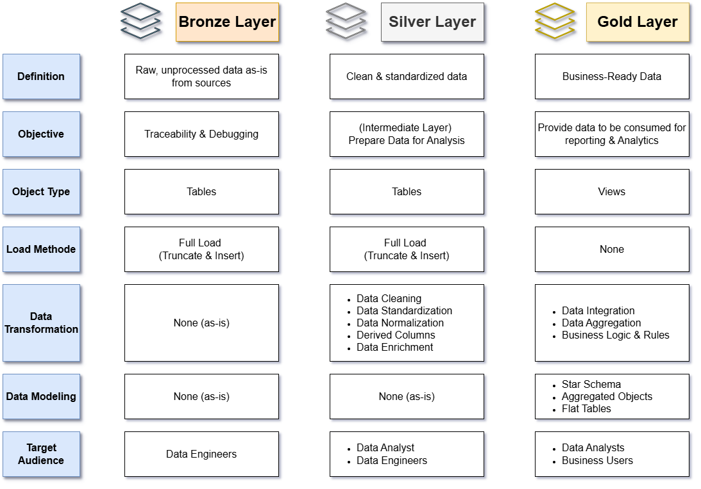
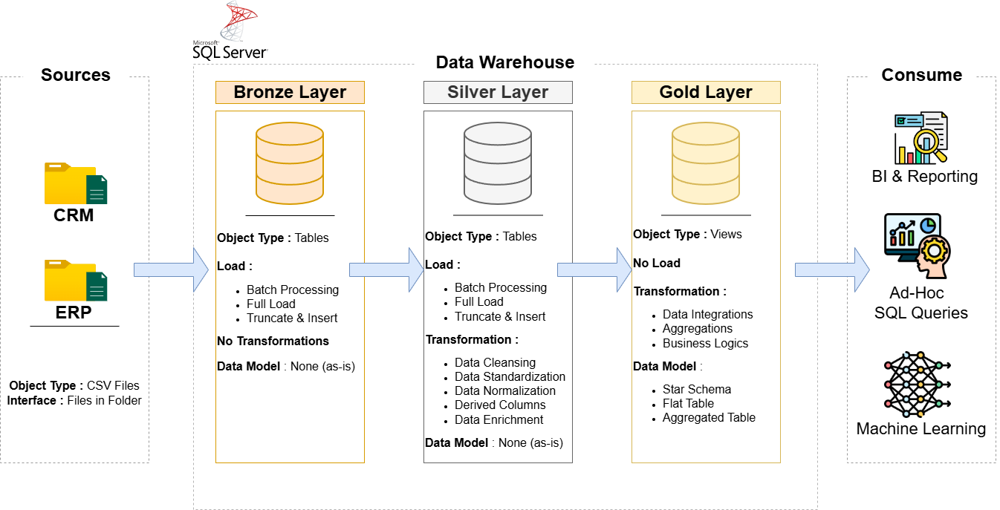
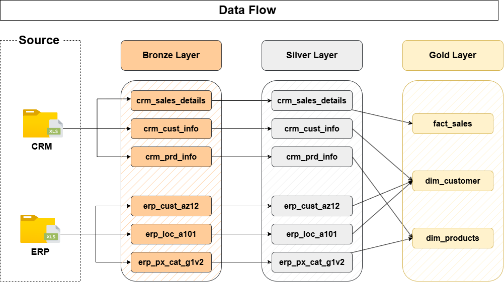
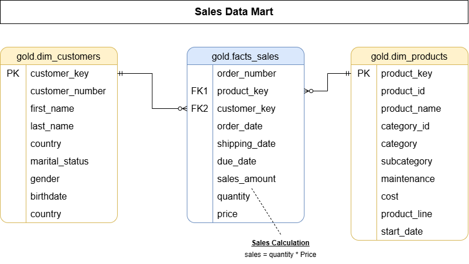
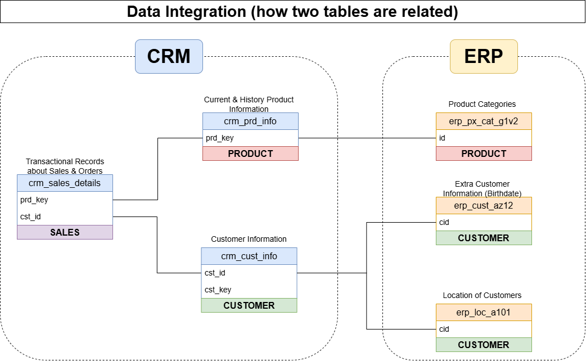

# Data Warehouse and Analytics Project

Welcome to the **Data Warehouse and Analytics Project** repository! 🚀  
This project demonstrates a comprehensive data warehousing and analytics solution, from building a data warehouse to generating actionable insights. Designed as a portfolio project, it highlights industry best practices in data engineering and analytics.
```
sql-data-warehouse-project/
├── datasets/               the six source files the project loads
│   ├── source_crm/         three files from the CRM system
│   └── source_erp/         three files from the ERP system
├── docs/                   the requirements, the diagrams and the notes
├── scripts/                the project scripts, in the order of the videos
│   ├── init_database.sql   creates the database: run it first
│   ├── bronze/             loads the raw files
│   ├── silver/             cleans and prepares the data
│   └── gold/               builds the tables for analysis
└── tests/                  checks the quality of the silver and gold data
```

The bronze loader, `scripts/bronze/proc_load_bronze.sql`, reads the six files from `C:\sql\dwh_project\datasets\`, the folder used in the videos. Put the folder there, or change the six paths in the script.

---
## 📊 Data Layers

The project organizes the data processing pipeline into three structured layers, detailing the definition, transformation methods, and target audiences:


1. **Bronze Layer**: Stores raw, unprocessed data as-is from source systems in physical tables, serving as an ingestion and auditing layer primarily for Data Engineers.
2. **Silver Layer**: Acts as an intermediate layer where physical tables undergo data cleaning, normalization, and enrichment to prepare high-quality data for Data Engineers and Analysts.
3. **Gold Layer**: Exposes business-ready data through analytical views (such as Star Schemas and aggregated objects), tailored for consumption by Data Analysts and Business Users.

---
## 🏗️ Data Architecture

The data architecture for this project follows Medallion Architecture **Bronze**, **Silver**, and **Gold** layers:


1. **Bronze Layer**: Stores raw data as-is from the source systems. Data is ingested from CSV Files into SQL Server Database.
2. **Silver Layer**: This layer includes data cleansing, standardization, and normalization processes to prepare data for analysis.
3. **Gold Layer**: Houses business-ready data modeled into a star schema required for reporting and analytics.

---
##  🔗 Data Flow

The data flow illustrates how raw source files progress through the Medallion architecture into final analytical tables:   
1. **Bronze Layer**: Raw CSV datasets from CRM and ERP source systems are ingested as-is into staging tables (crm_sales_details, crm_cust_info, crm_prd_info, erp_cust_az12, erp_loc_a101, erp_px_cat_g1v2).   
2. **Silver Layer**: Staging data is cleaned, standardized, and stored in corresponding Silver tables.   
3. **Gold Layer**: Cleaned Silver tables are consolidated into final star schema views, mapping sales data to fact_sales, customer profiles to dim_customer, and product catalogs to dim_products.  

---
## 📐 Data Model (Sales Data Mart)

The data model for the Gold Layer is designed as a Star Schema optimized for analytical queries, business reporting, and data analysis:


1. gold.facts_sales (Fact Table): Stores transactional sales metrics (sales_amount, quantity, price) along with foreign keys connecting to dimension tables. Includes core business calculations (e.g., sales = quantity * price).
2. gold.dim_customers (Dimension Table): Contains consolidated customer attributes (demographics, contact info, and country details) linked via customer_key.
3. gold.dim_products (Dimension Table): Holds product metadata (categories, subcategories, line, and cost specifications) linked via product_key.
---
##  🔗 Data Integration

Data integration combines information from two distinct source systems (CRM and ERP) into a unified structure. Transactional sales records (crm_sales_details) link to product information (crm_prd_info) via prd_key, which connects to ERP product categories (erp_px_cat_g1v2). Similarly, customer sales link to customer profiles (crm_cust_info) via cst_id, which enriches demographic data by connecting to ERP customer birthdates (erp_cust_az12) and customer locations (erp_loc_a101) via cid.

---

## 📖 Project Overview

This project involves:

1. **Data Architecture**: Designing a Modern Data Warehouse Using Medallion Architecture **Bronze**, **Silver**, and **Gold** layers.
2. **ETL Pipelines**: Extracting, transforming, and loading data from source systems into the warehouse.
3. **Data Modeling**: Developing fact and dimension tables optimized for analytical queries.
4. **Analytics & Reporting**: Creating SQL-based reports and dashboards for actionable insights.

🎯 This repository is an excellent resource for professionals and students looking to showcase expertise in:
- SQL Development
- Data Architect
- Data Engineering  
- ETL Pipeline Developer  
- Data Modeling  
- Data Analytics  

---

## 🛠️ Important Links & Tools:

- **[Datasets](datasets/):** Access to the project dataset (csv files).
- **[SQL Server Express](https://www.microsoft.com/en-us/sql-server/sql-server-downloads):** Lightweight server for hosting your SQL database.
- **[SQL Server Management Studio (SSMS)](https://learn.microsoft.com/en-us/sql/ssms/download-sql-server-management-studio-ssms?view=sql-server-ver16):** GUI for managing and interacting with databases.
- **[Git Repository](https://github.com/):** Set up a GitHub account and repository to manage, version, and collaborate on your code efficiently.
- **[DrawIO](https://www.drawio.com/):** Design data architecture, models, flows, and diagrams.
- **[Notion](https://www.notion.com/templates/sql-data-warehouse-project):** Get the Project Template from Notion
- **[Notion Project Steps](https://thankful-pangolin-2ca.notion.site/SQL-Data-Warehouse-Project-16ed041640ef80489667cfe2f380b269?pvs=4):** Access to All Project Phases and Tasks.

---

## 🚀 Project Requirements

### Building the Data Warehouse (Data Engineering)

#### Objective
Develop a modern data warehouse using SQL Server to consolidate sales data, enabling analytical reporting and informed decision-making.

#### Specifications
- **Data Sources**: Import data from two source systems (ERP and CRM) provided as CSV files.
- **Data Quality**: Cleanse and resolve data quality issues prior to analysis.
- **Integration**: Combine both sources into a single, user-friendly data model designed for analytical queries.
- **Scope**: Focus on the latest dataset only; historization of data is not required.
- **Documentation**: Provide clear documentation of the data model to support both business stakeholders and analytics teams.

---

### BI: Analytics & Reporting (Data Analysis)

#### Objective
Develop SQL-based analytics to deliver detailed insights into:
- **Customer Behavior**
- **Product Performance**
- **Sales Trends**

These insights empower stakeholders with key business metrics, enabling strategic decision-making.  

---

## 🤝 Connect

[](https://www.linkedin.com/in/radjakurniawan/)
